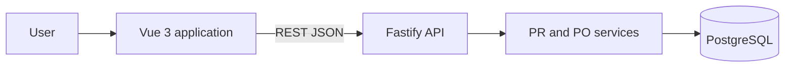
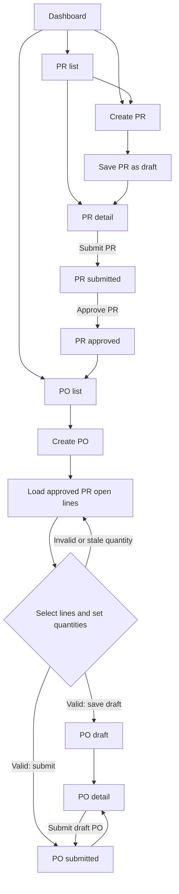
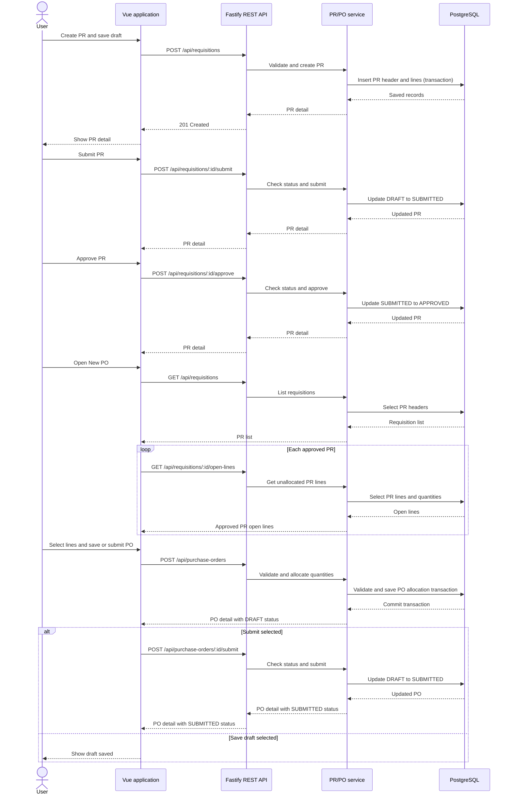

# How the Procurement MVP Works

This guide describes the application as it is currently implemented. It covers the Dashboard, Purchase Requisition (PR), and Purchase Order (PO) workflows. Goods Receipt (GR) is not implemented.

## Application Structure

The browser runs a Vue 3 application. Vue pages call the REST API through `frontend/src/api.js`; the Fastify backend routes requests to service functions, which read and write PostgreSQL. The database runs in Docker.

## User Workflow

The Dashboard links to the PR and PO lists and shows PR totals by status, plus the five most recently created PRs. To create a PO, at least one PR must be approved and have unallocated quantity remaining.

### Purchase Requisitions

1. From the Dashboard or PR list, open **New PR** and enter the requester, department, title, and one or more item lines. Each line needs an item code/name, positive requested quantity, unit of measure, estimated unit price, and site; optional fields include dates, notes, and budget center.
2. **Save As Draft** creates the PR and opens its detail page. The detail page shows the saved header and lines.
3. Submit a draft PR. The detail page then offers **Approve PR** for a submitted PR. These actions are restricted to the `DRAFT → SUBMITTED → APPROVED` sequence.

### Purchase Orders

1. Open **Purchase Orders** and choose **New PO**. The page loads open lines from approved PRs; fully allocated lines are excluded. If none are available, approve a PR with remaining quantity first.
2. Enter a vendor, select PR lines, and set order quantities. Delivery address defaults to the PR line's site, and delivery date defaults to that line's required date. The page shows the selected-line count and estimated total.
3. Choose **Save As Draft** to create a draft PO, or **Submit PO** to create it and submit it immediately. A draft can also be submitted from its detail page. Once saved from the create page, its form is locked because there is no PO update operation.
4. The PO list links to details showing the vendor, status, PO lines, quantities, and their source PR allocations.

PO validation requires a vendor and at least one selected line. Each quantity must be positive and no greater than the source PR line's remaining quantity; unit price cannot be negative and the delivery site is required. The backend rechecks that each PR is approved and locks its line during allocation, so a stale or concurrent over-allocation is rejected with HTTP `422` and a message. A PO can only transition from `DRAFT` to `SUBMITTED`.

Currency, payment terms, and notes are displayed in the generated PO form but are not stored by the current API/schema. There is no PO edit operation.

## Request Sequence

This sequence shows the main path from a new requisition through a submitted purchase order. The frontend obtains approved PR open lines before showing allocation choices. A submit from the PO create page first creates a draft, then submits it.

## Main Pages and API

| Page      | Route                  | Main API calls                                                                                                                       |
| --------- | ---------------------- | ------------------------------------------------------------------------------------------------------------------------------------ |
| Dashboard | `/`                    | `GET /api/requisitions`                                                                                                              |
| PR list   | `/requisitions`        | `GET /api/requisitions`                                                                                                              |
| PR create | `/requisitions/new`    | `POST /api/requisitions`                                                                                                             |
| PR detail | `/requisitions/:id`    | `GET /api/requisitions/:id`, `POST /api/requisitions/:id/submit`, `POST /api/requisitions/:id/approve`                               |
| PO list   | `/purchase-orders`     | `GET /api/purchase-orders`                                                                                                           |
| PO create | `/purchase-orders/new` | `GET /api/requisitions`, `GET /api/requisitions/:id/open-lines`, `POST /api/purchase-orders`, `POST /api/purchase-orders/:id/submit` |
| PO detail | `/purchase-orders/:id` | `GET /api/purchase-orders/:id`, `POST /api/purchase-orders/:id/submit`                                                               |

The API also exposes `GET /api/purchase-orders/:id/open-lines` for PO lines with quantity still open for receipt. It does not create or post receipts. There are no GR pages or GR routes in the current application, and the Dashboard's GR wording is informational only; it does not show GR data.
