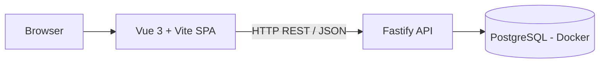
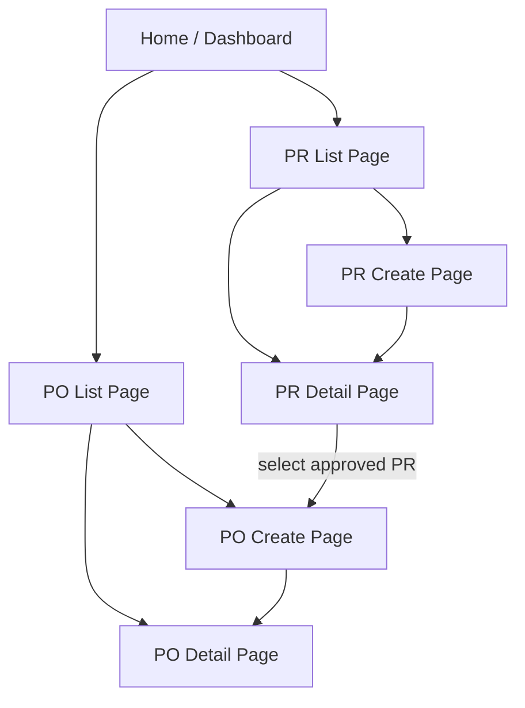
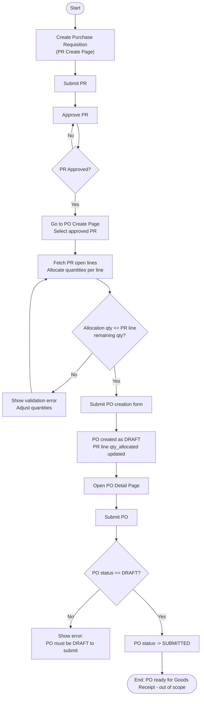
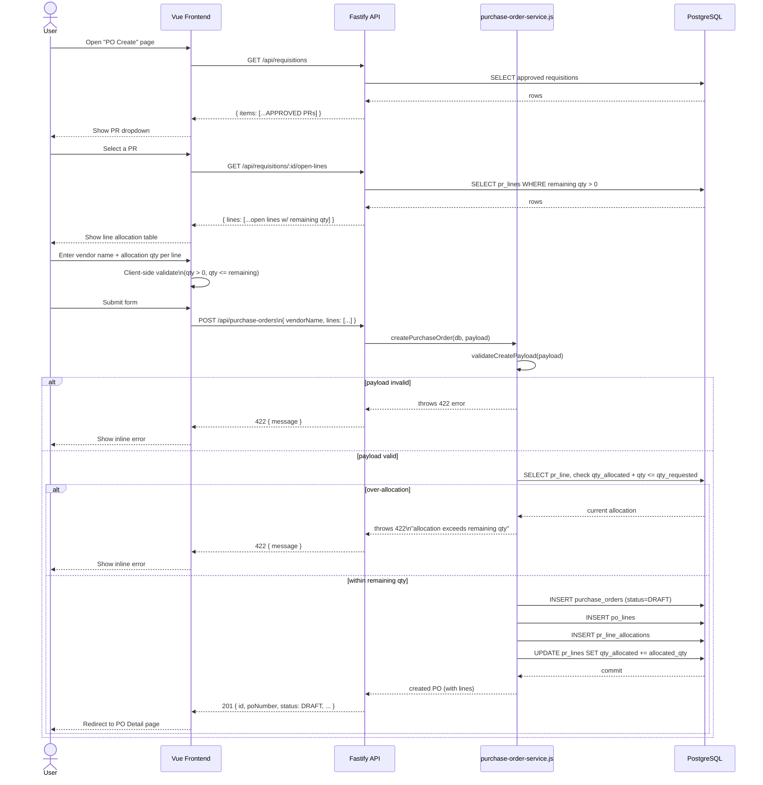
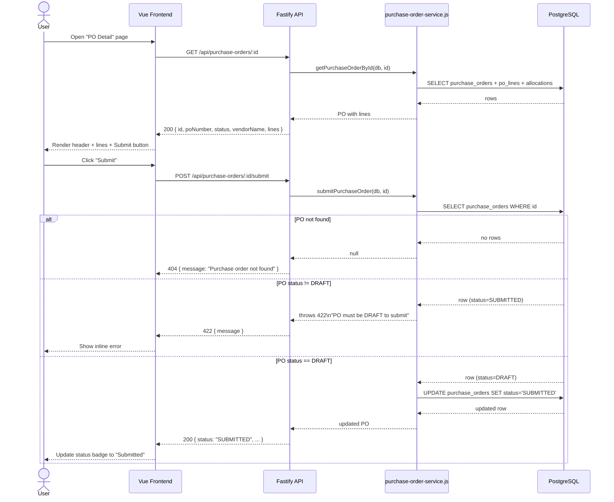

# Application Overview: Procurement MVP

This document describes how the current application works end-to-end: architecture, page navigation, user flow, and the request/response sequence for the core Purchase Requisition (PR) → Purchase Order (PO) flow.

> For the full data model, API scope, and workshop plan, see [plan.md](./plan.md). For the latest implementation status, see [progress.md](./progress.md).

## 1. What the app does

The app is a small procurement management system covering:

- **Purchase Requisition (PR)** — an employee requests items/services (`DRAFT → SUBMITTED → APPROVED`).
- **Purchase Order (PO)** — approved PR lines are allocated into a PO sent to a vendor (`DRAFT → SUBMITTED`).
- **Goods Receipt (GR)** — receiving items against a PO (out of scope for this workshop's implementation, schema/API only).

The PR module and Dashboard are prebuilt in the baseline. The PO module (list/create/detail + validations) is the participant implementation focus.

## 2. Architecture

- **Frontend**: Vue 3 + Vite, plain JavaScript, `vue-router` for page navigation, a single `frontend/src/api.js` module wrapping `fetch` calls.
- **Backend**: Fastify, JavaScript, REST/JSON, thin route handlers that delegate business rules to service modules.
- **Database**: PostgreSQL running in Docker, schema defined in `db/migrations/001_init_procurement_mvp.sql`.

## 3. Pages and navigation

Routes (`frontend/src/router/index.js`):

| Path | Page | Purpose |
|---|---|---|
| `/` | `DashboardPage` | Overview stats + recent PRs |
| `/requisitions` | `RequisitionListPage` | List all PRs |
| `/requisitions/new` | `RequisitionCreatePage` | Create a PR |
| `/requisitions/:id` | `RequisitionDetailPage` | View/submit/approve a PR |
| `/purchase-orders` | `POListPage` | List all POs |
| `/purchase-orders/new` | `POCreatePage` | Create a PO from an approved PR's open lines |
| `/purchase-orders/:id` | `PODetailPage` | View/submit a PO |

## 4. End-to-end user flow

## 5. Sequence diagram: Create Purchase Order

This covers the primary participant backlog flow: selecting an approved PR, allocating its open lines, and creating a PO.

## 6. Sequence diagram: Submit Purchase Order

## 7. Key business rules

- **Allocation limit**: `allocated qty <= PR line remaining qty` (`qty_requested - qty_allocated`), enforced both client-side (immediate feedback) and server-side (authoritative, `422` on violation).
- **PR must be `APPROVED`** before its lines can be allocated to a PO.
- **PO must be `DRAFT`** to be submitted; submitting a non-`DRAFT` PO returns `422`.
- Route handlers stay thin; all business rules live in `backend/src/services/*-service.js`.
